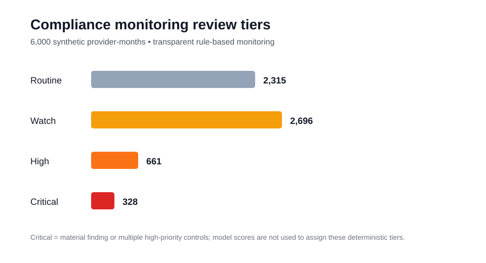
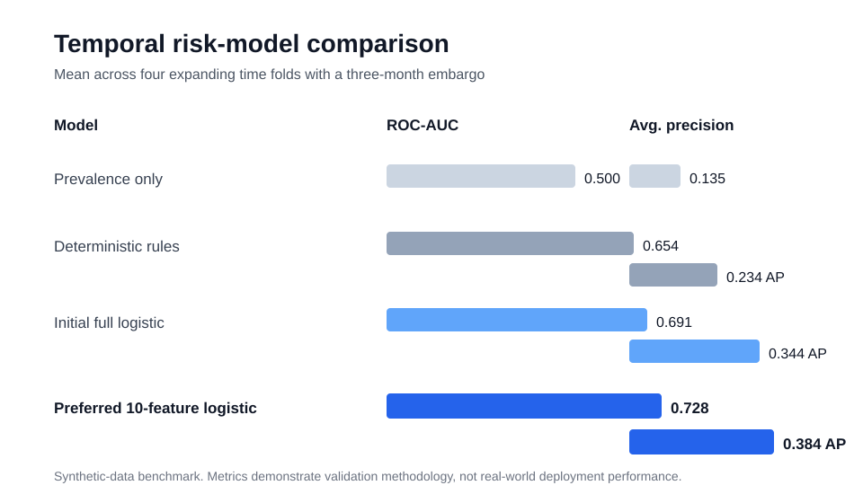
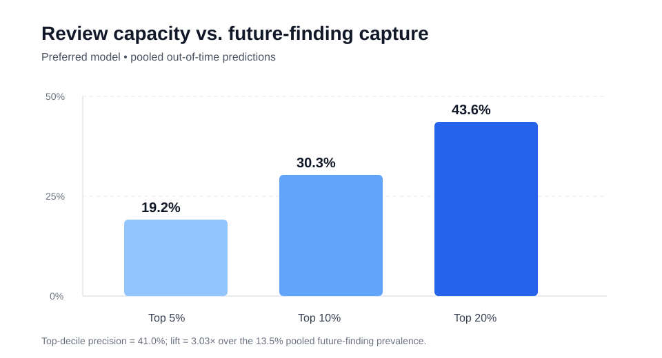

# Public Program Compliance Monitoring & Risk Analytics

A portfolio project simulating a state-administered regulated program to demonstrate SQL-based compliance monitoring, KPI reporting, exception detection, and predictive risk analytics.


## Project snapshot

- **250** synthetic regulated providers
- **6,000** provider-month observations
- **1,046** corrective actions
- **59** overdue open corrective actions
- **10-feature** preferred compliance-risk model
- mean temporal ROC-AUC: **0.728**
- mean temporal average precision: **0.384**
- top 10% of predicted risk captures **30.3%** of out-of-time future findings
- provider type and region excluded from prediction and retained for segment auditing

[Read the executive summary](docs/EXECUTIVE_SUMMARY.md)







## Core question

Which regulated entities show patterns that warrant additional compliance review, and how can limited monitoring resources be prioritized?

## Technical stack

**SQL · SQLite · Python · pandas · NumPy · scikit-learn · pytest · GitHub Actions**

## Analyst layer

- SQL cohort construction
- data validation
- compliance KPIs
- exception monitoring
- overdue corrective-action tracking
- repeat-violation analysis
- dashboard-ready reporting

## Data science extension

- compliance-risk prediction
- anomaly detection
- threshold tuning
- calibration
- explainability
- temporal validation

## Initial scenario

The project simulates a network of regulated service providers with monthly operational and compliance data, including:

- case volume
- staffing and caseload pressure
- complaints
- report timeliness
- documentation completeness
- corrective actions
- material compliance findings

The first predictive outcome is whether a provider receives a material finding within the following 90 days.

## Milestone 1 — compliance monitoring foundation

**Complete**

The first analyst-facing pipeline now runs end to end:

```text
synthetic provider-month data
        ↓
SQLite compliance database
        ↓
SQL KPI monitoring
        ↓
rule-based exception table
        ↓
provider scorecard
        ↓
ranked human-review queue
```

Validated synthetic dataset:

| Measure | Result |
| --- | ---: |
| Providers | **250** |
| Provider-month rows | **6,000** |
| Months | **24** |
| Material findings | **292** |
| Providers with any rule exception | **210** |
| Mean rule exceptions per provider | **5.93** |

The monitoring layer currently flags severe late reporting, low documentation completeness, unresolved corrective actions, and elevated complaint rates.

[Read the Milestone 1 scorecard findings](docs/MILESTONE1_SCORECARD.md)

## Milestone 2 — monitoring logic and remediation analysis

**Complete**

The analyst layer now includes:

- repeat-violation logic
- 3-month trend monitoring
- control-level drilldowns
- threshold-sensitivity analysis
- transparent review severity tiers
- normalized corrective-action aging
- overdue-action monitoring
- ranked human-review queues with reason codes

Across 6,000 provider-months, the current deterministic review tiers are:

| Review tier | Provider-months |
| --- | ---: |
| Critical | **328** |
| High | **661** |
| Watch | **2,696** |
| Routine | **2,315** |

The corrective-action register contains **1,046 actions**, including **59 overdue open actions** and **8 high-severity overdue open actions**.

[Read the Milestone 2 monitoring findings](docs/MILESTONE2_MONITORING.md)

## Milestone 3 — predictive compliance-risk modeling

**Complete**

The project now predicts whether a provider will receive a material compliance finding during the next three fully observed months.

Validation uses four expanding temporal folds with a **three-month embargo** between training and testing.

| Model | ROC-AUC | Average precision | Brier score | Log loss |
| --- | ---: | ---: | ---: | ---: |
| Prevalence only | 0.500 | 0.135 | 0.1174 | 0.3984 |
| Rule benchmark | 0.654 | 0.234 | 0.1117 | 0.3764 |
| Initial full logistic | 0.691 | 0.344 | 0.1065 | 0.3627 |
| **Preferred 10-feature logistic** | **0.728** | **0.384** | **0.1030** | **0.3495** |
| Histogram gradient boosting | 0.649 | 0.288 | 0.1159 | 0.4130 |

Feature ablation further improved the logistic model by removing provider type, region, and lower-value operational-scale features. The preferred 10-feature compliance-only specification improves every validation metric while remaining interpretable.

Provider type and region are retained for segment auditing but excluded from prediction.

[Read the Milestone 3 modeling findings](docs/MILESTONE3_RISK_MODELING.md)

Because the data are synthetic, these performance metrics demonstrate methodology rather than expected real-world deployment performance.

## Milestone 4 — model diagnostics and decision support

**Complete**

Across 3,000 pooled out-of-time provider-months, the preferred model achieves:

- pooled ROC-AUC: **0.727**
- pooled average precision: **0.371**
- calibration intercept: **-0.057**
- calibration slope: **0.991**

Review-capacity analysis:

| Review capacity | Future findings captured | Precision | Lift |
| --- | ---: | ---: | ---: |
| Top 5% | **19.2%** | **52.0%** | **3.84×** |
| Top 10% | **30.3%** | **41.0%** | **3.03×** |
| Top 20% | **43.6%** | **29.5%** | **2.18×** |

Model-versus-rule overlap shows that predictive ranking and deterministic controls identify related but nonidentical review populations.

[Read the Milestone 4 diagnostic findings](docs/MILESTONE4_MODEL_DIAGNOSTICS.md)

## Current status

The core analyst and supervised data-science workflow is now complete:

```text
synthetic regulated-program data
        ↓
SQL monitoring + KPI reporting
        ↓
exceptions + repeat violations
        ↓
corrective-action aging
        ↓
severity tiers + review queues
        ↓
temporal predictive validation
        ↓
feature ablation
        ↓
calibration + capacity analysis
        ↓
segment auditing
```

Anomaly detection remains an optional extension. The next required work is portfolio presentation: concise figures, an executive summary, and a final repository quality pass.

All data are synthetic. No real program, provider, client, or case information is used.


## Documentation

- [Executive Summary](docs/EXECUTIVE_SUMMARY.md)
- [Research Design](docs/RESEARCH_DESIGN.md)
- [Milestone 1 — Compliance Monitoring Scorecard](docs/MILESTONE1_SCORECARD.md)
- [Milestone 2 — Monitoring Logic, Trends, and Remediation](docs/MILESTONE2_MONITORING.md)
- [Milestone 3 — Predictive Compliance-Risk Modeling](docs/MILESTONE3_RISK_MODELING.md)
- [Milestone 4 — Model Diagnostics & Decision Support](docs/MILESTONE4_MODEL_DIAGNOSTICS.md)


## Responsible use

This is a synthetic portfolio project. Risk scores are designed to prioritize human review, not establish noncompliance or automate enforcement. Provider type and region are excluded from the preferred model and retained only for segment auditing.


## License

This project is released under the [MIT License](LICENSE).
